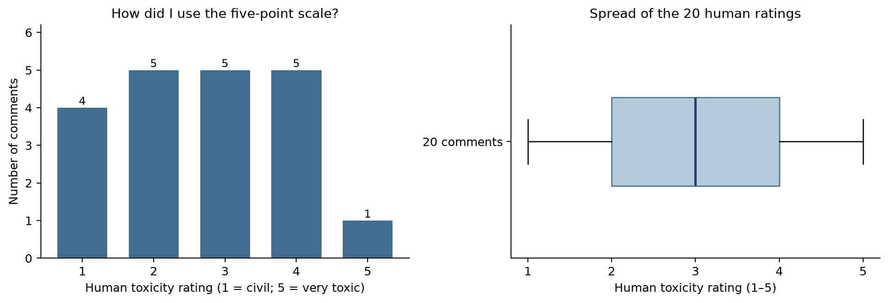
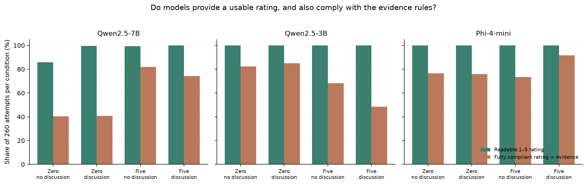
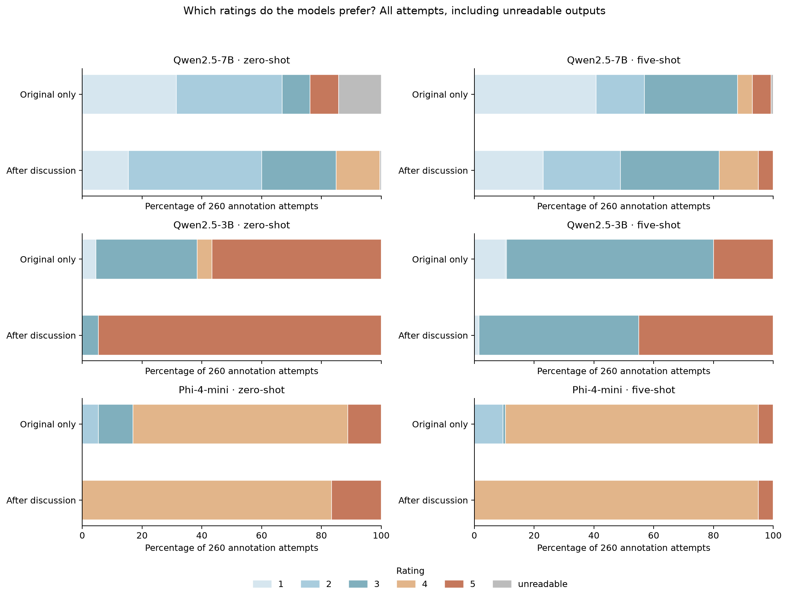
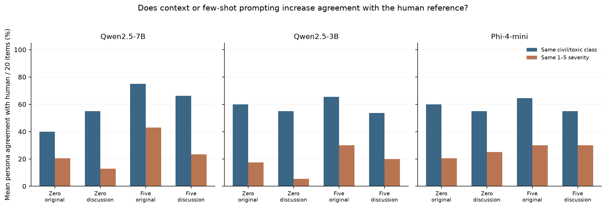
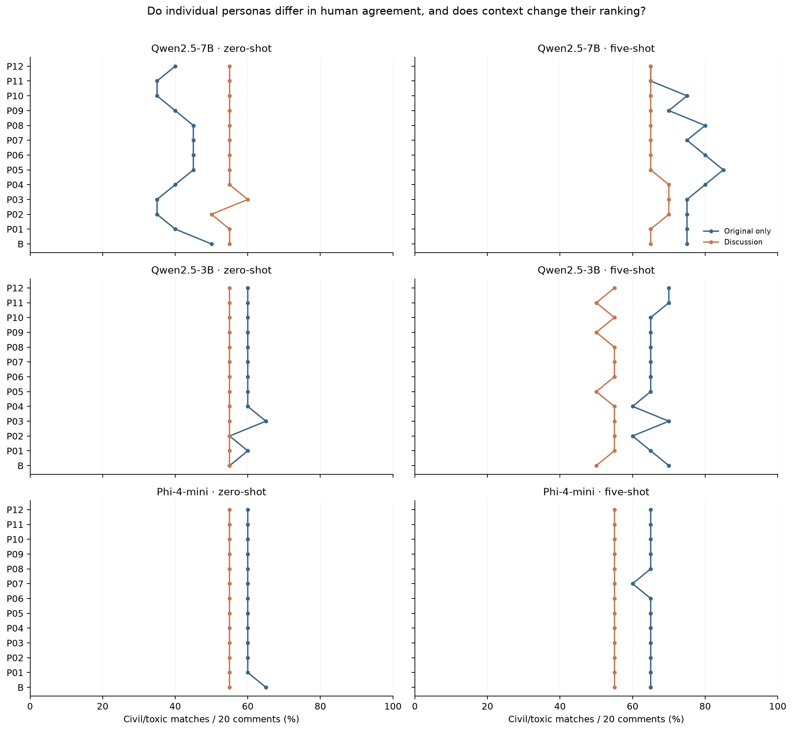
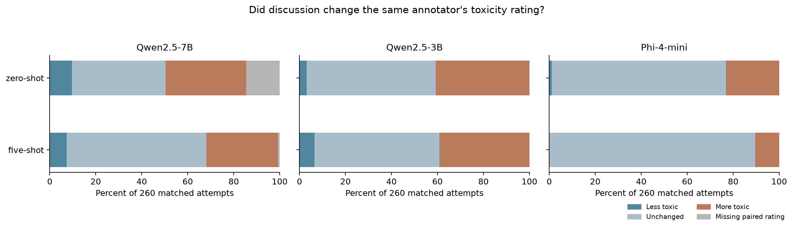
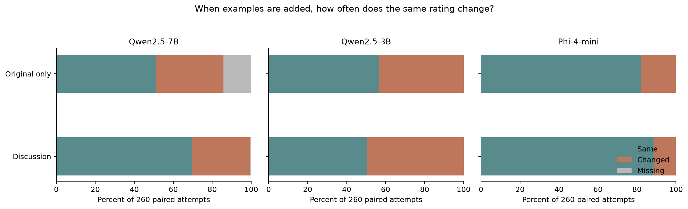
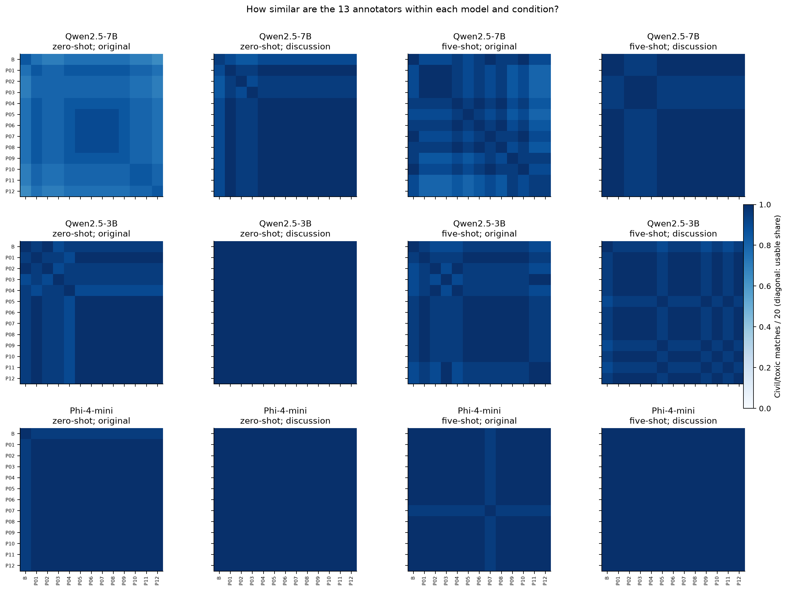
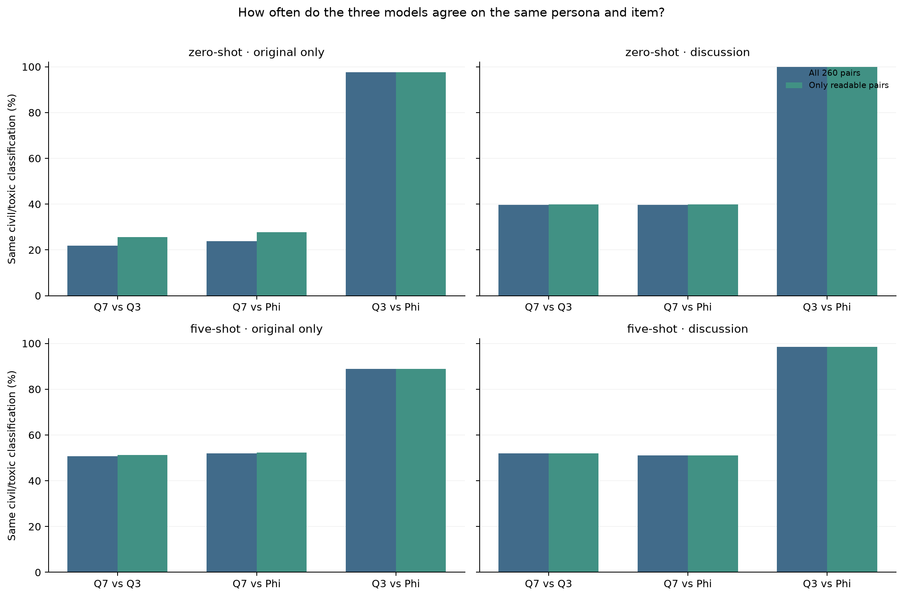

# Persona annotation, discussion context and few-shot prompting

**Analysis of the completed experiment**  
MSc Practical Data Science · Assignment 1  
Sampling seed: `3352606` · [Project repository](https://github.com/georgeVlc/ds-assignment-1/)

## Contents

1. [Design and how to read the results](#1-design-and-how-to-read-the-results)
2. [The human reference — Figure 1](#2-the-human-reference--figure-1)
3. [Rating reliability and evidence — Figure 2](#3-rating-reliability-and-evidence--figure-2)
4. [Which severity levels the models use — Figure 3](#4-which-severity-levels-the-models-use--figure-3)
5. [Agreement with the human annotations — Figures 4–5](#5-agreement-with-the-human-annotations--figures-45)
6. [The effect of discussion context — Figure 6](#6-the-effect-of-discussion-context--figure-6)
7. [The effect of examples — Figure 7](#7-the-effect-of-examples--figure-7)
8. [Do the personas behave differently? — Figure 8](#8-do-the-personas-behave-differently--figure-8)
9. [Agreement between models — Figure 9](#9-agreement-between-models--figure-9)
10. [Kappa, limitations and conclusion](#10-kappa-limitations-and-conclusion)

## 1. Design and how to read the results

I compared three 4-bit instruction-tuned models: Qwen2.5-7B, Qwen2.5-3B and Phi-4-mini. Each annotated the same 20 news comments, using 12 personas formed from political outlook, age and gender, plus a baseline without a persona. Two factors were varied independently: whether the annotator had read a generated discussion of the comment, and whether the instruction included five worked examples. This gives **3 models × 13 annotators × 20 items × 2 context conditions × 2 prompting conditions = 3,120 attempts**. The human ratings were completed beforehand and were not altered.

There are two different meanings of *valid* in the notebook. A **usable rating** is an identifiable number from 1 to 5. A **fully compliant answer** also follows the required format and evidence rules. I use usable ratings for the primary agreement calculations and report evidence failures separately. When calculating agreement over the original 20 items, an unreadable rating counts as a non-match; I also inspect conditional agreement where useful. This matters particularly when interpreting model differences.

The main agreement measures are the percentage of identical **civil/toxic labels** (1–2 versus 3–5) and the percentage of identical **exact 1–5 scores**. All comparisons are matched by comment ID. The raw percentages are the assignment's primary metrics; Cohen's kappa is supplementary.

## 2. The human reference — Figure 1

My annotations span the full scale: four comments received 1, five received 2, five received 3, five received 4 and one received 5. The median is **3**, with the middle half of the ratings between **2 and 4**. There are **9 civil** and **11 toxic** comments under the assignment's threshold.

This is a reasonably balanced *binary* reference, but not a uniform five-category reference. Rating 5 is rare: I reserved it for the clearest extreme cases. Consequently, a model that repeatedly predicts 5 may look moderately successful on the binary task while being very poor at severity estimation. With only 20 items, one additional match changes an individual annotator's agreement by **five percentage points**. Small differences between personas should therefore be treated cautiously.

## 3. Rating reliability and evidence — Figure 2

The earlier experiments conflated evidence-format failures with missing toxicity judgments. The revised parser largely resolves that: **3,080 of 3,120 answers (98.7%) contain a usable numeric rating**, although only **2,180 (69.9%) are fully compliant** with all evidence and formatting rules.

All **40 unreadable answers come from Qwen2.5-7B**; 37 occur in the zero-shot/no-discussion condition, two in five-shot/no-discussion and one in zero-shot/discussion. Both Qwen2.5-3B and Phi-4-mini return a readable rating in all 1,040 attempts each. This means that the large gaps between the green and orange bars are mostly **evidence or presentation failures**, not missing numeric predictions.

The compliance patterns differ. Qwen2.5-7B's strict compliance rises from about **40% in zero-shot** to **82% without discussion / 74% with discussion in five-shot**, suggesting that examples help it follow the evidence instructions. Qwen2.5-3B moves in the opposite direction, from roughly **82–85%** zero-shot compliance to **68% without discussion / 48% with discussion** in five-shot. The raw responses show cases where it copies evidence from an example instead of the actual comment. Phi-4-mini reaches its best compliance (**92%**) with five-shot prompting and discussion.

A subtle but important finding is that **good formatting does not imply good labels**. Phi is often the most compliant model, but its agreement with the human reference is not the highest. The evidence checks are useful quality control, not a substitute for evaluating ratings.

## 4. Which severity levels the models use — Figure 3

The distributions explain much of the agreement results. Qwen2.5-7B uses all five categories and is the only model to produce a substantial number of **civil (1–2)** predictions. Under zero-shot prompting, discussion shifts its ratings away from 1 and towards 2–4. Five-shot prompting alters its calibration again: it introduces more 3s and makes the no-discussion distribution less concentrated at the extremes.

Qwen2.5-3B is different. In **zero-shot with discussion, 246/260 predictions are 5**. Without discussion it is less extreme, and examples make a much bigger difference: in five-shot/no-discussion, **180/260 responses are 3**, compared with **147/260 rated 5** in zero-shot/no-discussion. The examples therefore seem to teach it that ordinary insults need not receive the maximum severity. But this is not consistently robust: its five-shot/discussion condition still contains **117 ratings of 5**, alongside 139 ratings of 3.

Phi-4-mini is remarkably concentrated around **4**, especially in five-shot: 220/260 ratings are 4 without discussion and 247/260 with discussion. It rarely uses the lower end of the scale, even though 45% of the human reference is civil. Phi's consistency is therefore better described as a **stable high-toxicity preference** than as careful separation of severity levels.

The models' mean ratings reinforce this: across all conditions Qwen2.5-7B averages **2.30**, Qwen2.5-3B **4.01**, and Phi-4-mini **3.99**. Similar average severity for the two smaller models hides different habits: Qwen3B often jumps between 3 and 5, whereas Phi generally settles on 4.

## 5. Agreement with the human annotations — Figures 4–5

This is the clearest test of whether the models annotate like the human reference. The table gives mean agreement across the **12 personas**, with every score expressed out of the same 20 items; the baseline is discussed separately.

| Model | Prompting and context | Same civil/toxic class | Same exact rating |
|---|---|---:|---:|
| Qwen2.5-7B | Zero-shot, original only | 40.0% | 20.4% |
| Qwen2.5-7B | Zero-shot, discussion | 55.0% | 12.9% |
| Qwen2.5-7B | Five-shot, original only | **75.0%** | **42.9%** |
| Qwen2.5-7B | Five-shot, discussion | 66.3% | 23.3% |
| Qwen2.5-3B | Zero-shot, original only | 60.0% | 17.5% |
| Qwen2.5-3B | Zero-shot, discussion | 55.0% | 5.4% |
| Qwen2.5-3B | Five-shot, original only | 65.4% | 30.0% |
| Qwen2.5-3B | Five-shot, discussion | 53.8% | 20.0% |
| Phi-4-mini | Zero-shot, original only | 60.0% | 20.4% |
| Phi-4-mini | Zero-shot, discussion | 55.0% | 25.0% |
| Phi-4-mini | Five-shot, original only | 64.6% | 30.0% |
| Phi-4-mini | Five-shot, discussion | 55.0% | 30.0% |

Qwen2.5-7B benefits most from five-shot prompting **without discussion**: binary agreement increases by **35 percentage points** and exact agreement by about **22.5 points** relative to zero-shot/no-discussion. This is more than a formatting improvement: nearly all its five-shot ratings are readable, and the model's chosen categories move closer to the reference.

Context is not automatically helpful. For Qwen7B in zero-shot, binary agreement *increases* from 40% to 55%, but exact agreement *falls* from 20.4% to 12.9%. The model more often lands on the correct side of the civil/toxic threshold without matching the human severity. In five-shot, adding discussion reduces both measures. For Qwen3B and Phi, the no-discussion condition also generally has higher binary agreement. A model can become more certain or more severe after a discussion without becoming more accurate.

The persona-level plot makes the model effect easier to see. Under Qwen7B five-shot/no-discussion, the highest-ranking persona is **centrist, 18–29, woman**, matching **17/20 binary labels and 10/20 exact ratings**. The baseline achieves **15/20 and 8/20**. With discussion, the leading persona becomes **progressive, 18–29, man**, at **14/20 binary and 5/20 exact**, compared with the baseline's **13/20 and 5/20**. The lead is small and the identity changes when context changes.

The apparently best persona does not always outperform the baseline. Under Qwen7B zero-shot/no-discussion, the top persona reaches only **9/20** binary matches, whereas the baseline reaches **10/20**. Most of the Qwen3B and Phi persona lines are nearly flat, indicating that different demographic descriptions rarely produce meaningfully different results. These rankings should not be interpreted as evidence that the human annotator belongs to any of these demographic groups.

## 6. The effect of discussion context — Figure 6

Figure 6 holds the model, persona, item and shot setting fixed. The most consistent pattern is **upward movement in toxicity**. In zero-shot, Qwen7B raises 91 paired ratings and lowers 25; Qwen3B raises 106 and lowers 8; Phi raises 60 and lowers 3. With five-shot prompts, the increases remain more common: **81 versus 19** for Qwen7B, **102 versus 17** for Qwen3B, and **27 versus 0** for Phi. These counts refer only to pairs where both ratings are readable.

The discussion effect is especially visible in the smaller models. Qwen3B's mean rating rises from **4.09 to 4.89** in zero-shot; Phi's rises from **3.89 to 4.17**. In both cases there is little space left for a rating to increase once it is already near the top of the scale. Phi changes fewer ratings under five-shot because so many are already fixed at 4.

Qwen7B has **38 unmatched zero-shot pairs** because at least one rating is unreadable; the corresponding five-shot number is only **2**. The missing segment should not be mistaken for unchanged judgments. Most importantly, the upward movement often reduces exact agreement with the human. The discussions may draw attention to conflict and hostility, but this is an interpretation of the pattern, not proof of the mechanism.

## 7. The effect of examples — Figure 7

This comparison holds the comment, model, persona and discussion setting fixed, changing only whether the model sees five demonstrations. Qwen3B reacts most strongly: examples change **113/260** ratings without discussion and **129/260** with discussion. **Every readable Qwen3B change moves downward**, not upward. This fits Figure 3: examples shift the model away from its default rating of 5, often towards 3 or occasionally 1–2. Its average severity drops by about **0.90 points** without discussion and **1.02 points** with discussion.

Qwen7B changes **90/260** paired ratings without discussion and **78/260** with discussion; however, 37 and 1 pairs respectively cannot be compared. Its five-shot effect is much less one-directional: among matched items without discussion, **76 ratings increase and 14 decrease**. The improvement in human agreement is therefore not simply due to making everything more lenient; it is related to where individual decisions move relative to the reference.

Phi responds least to the examples: **47/260** ratings change without discussion and **30/260** with it. In the discussion condition, all 30 changes are downward. Yet most five-shot Phi ratings remain 4. Few-shot prompting changes the behavior of the models in quite different ways, even though the examples and rubric are the same.

## 8. Do the personas behave differently? — Figure 8

Each heatmap compares the same 13 annotators in the same order (**B**, then **P01–P12**). Dark blue means higher agreement on civil/toxic labels across 20 comments. There are **78 distinct pairs** in each panel. The diagonal shows the share of usable outputs, rather than an annotator's agreement with itself.

The dominant result is **high inter-persona similarity**, especially in Qwen3B and Phi. For example, Qwen3B reaches **100% mean binary pairwise agreement** under zero-shot/discussion, and Phi reaches **100%** in both discussion conditions. Phi's five-shot/discussion ratings are actually identical across all 13 annotators: pairwise **exact** agreement is also **100%**.

That sounds impressive until it is compared with Figure 4: Phi's exact agreement with the human in that setting is only **30%**. A group can agree perfectly because everyone makes the same poorly calibrated judgment. Qwen7B has more visible persona variation, particularly in zero-shot/no-discussion, but its mean binary pairwise agreement still ranges from about **80% to 98%** across the four conditions. These differences are too small and model-dependent to support conclusions about real demographic groups.

## 9. Agreement between models — Figure 9

Figure 9 compares the three models on exactly the same **260 persona–comment pairs** per condition. The two bars distinguish agreement over all attempts from agreement restricted to pairs with readable ratings. The latter is useful for diagnosing missingness, but cannot tell us whether the shared label is correct.

Qwen3B and Phi have exceptionally high **binary** agreement: **97.7%** in zero-shot/original, **100%** in zero-shot/discussion, **88.8%** in five-shot/original and **98.5%** in five-shot/discussion. Their severity agreement is nowhere near as high. In zero-shot/discussion, for instance, the two models agree on the civil/toxic label in **260/260** cases, but on the exact rating in only **43/260 (16.5%)**. In five-shot/discussion, exact agreement falls to **13/260 (5%)**. They usually agree that a comment is toxic, but Qwen3B often prefers 3 or 5 where Phi prefers 4.

Qwen7B is more distinct from both smaller models. Its binary agreement with Qwen3B rises from **21.9% in zero-shot/original** to **50.8% in five-shot/original**; with Phi it rises from **23.8% to 51.9%**. These changes largely follow its own rating distribution becoming more toxic in five-shot. Comparing only readable pairs barely changes the five-shot percentages, so this pattern is not chiefly a missing-data artifact.

## 10. Kappa, limitations and conclusion

The supplementary Cohen's kappa tables support the distinction between genuine agreement and shared class preference. Averaged across the 13 annotators, Qwen7B's **binary κ is about 0.52** with five-shot/no-discussion, compared with approximately **0.09** in zero-shot/no-discussion. Its quadratic weighted κ for the five-level scale is about **0.57** in that best condition. Qwen3B reaches weighted κ of roughly **0.55** in five-shot/no-discussion, while Phi reaches **0.28**. These measures are calculated only from matched readable ratings, so their denominators can differ from the raw-agreement plots.

Kappa also highlights an edge case: when a model always assigns the same binary class, binary κ can be **zero or undefined**, even if two personas agree on every item. Phi's five-shot/discussion inter-persona weighted κ is **1.00**, but its mean weighted κ against the human is only around **0.07**. The former describes consistency; the latter reveals limited correspondence with the reference. With 20 items and strongly skewed predictions, kappa values should not be over-interpreted either.

There are several limits to the study. Twenty comments and one human annotator cannot establish broad human agreement or general model quality. Every persona reuses the same items and the same generated discussion, so the many annotation attempts are **not independent human observations**. Some discussions contain drift or speculative details; context may introduce cues that were not in the original comment. The five examples are fixed, and the instruction wording itself influences the labels. Lastly, an assigned persona is only a prompt description, not a representative sample of a demographic group.

**Overall, prompting and model choice matter more than the persona descriptions in this experiment.** Five-shot prompting helps Qwen7B most clearly, particularly when the original comment is read alone. Qwen3B learns to move away from maximum toxicity, while Phi remains concentrated near 4. Discussions often make comments seem more toxic but do not consistently bring the models closer to the human reference. The central lesson is that **agreement must be read together with rating distributions, formatting reliability and the possibility of constant-label behavior**: a high agreement percentage on its own can be quite misleading.
